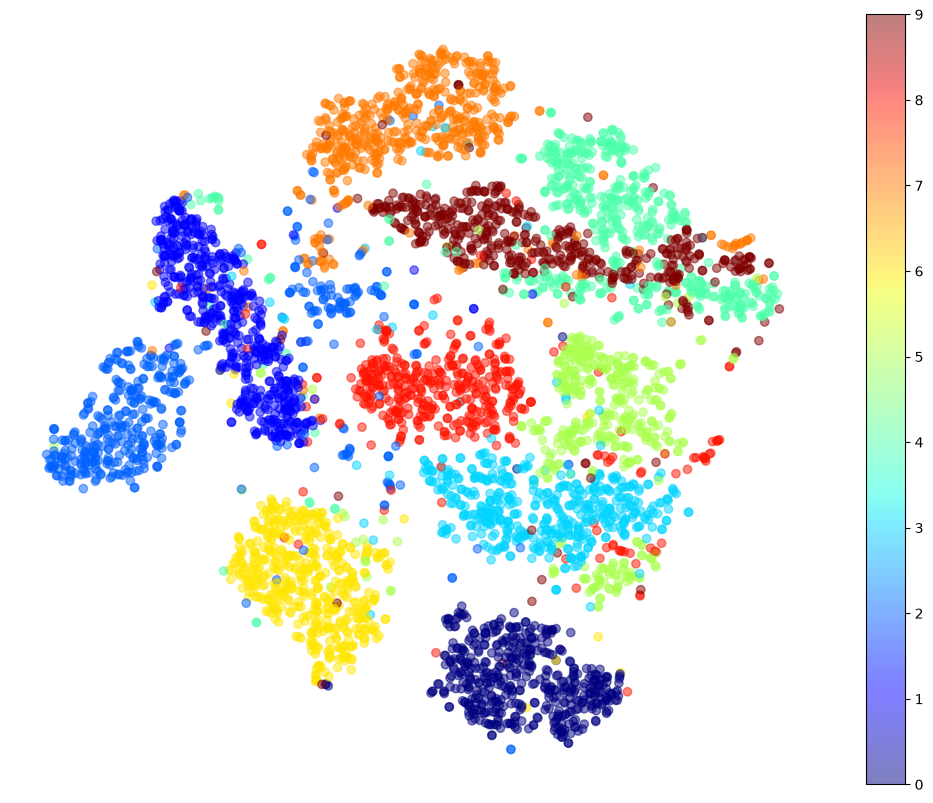
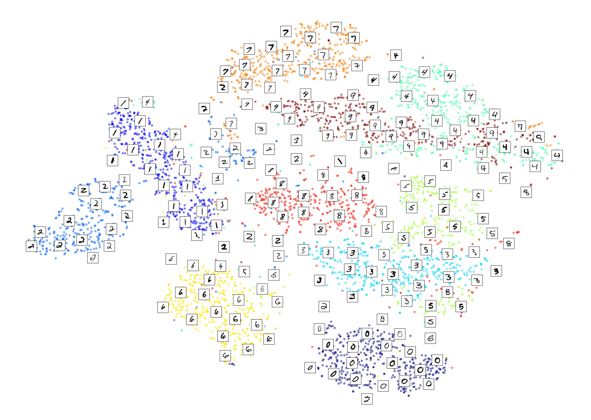
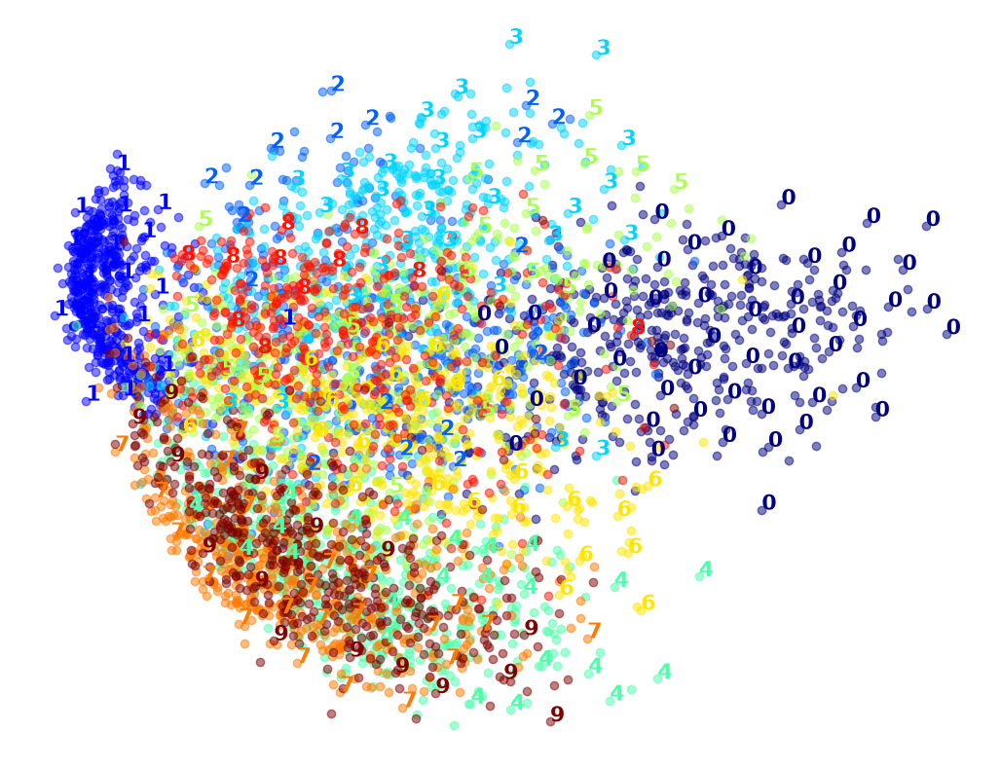
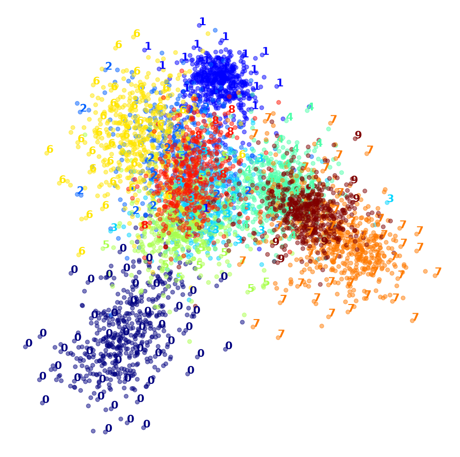

# Visualizing MNIST with t-SNE

This notebook squeezes the first 5,000 MNIST digit images (784 pixels each) down to two dimensions with t-SNE, then plots them. It then runs the same 5,000 images through PCA, LLE and LDA to compare. t-SNE gives by far the clearest picture: most digits form their own cluster, even though it never sees the labels.

This is exercise 10 from chapter 8 (Dimensionality Reduction) of *Hands-On Machine Learning* (Géron, 3rd edition).

## Results

| Method | Uses labels? | Time (5,000 images) | How well the digits separate |
|---|---|---|---|
| **t-SNE** | No | 26 s | **Clear clusters for almost every digit** |
| PCA | No | 0.2 s | Only 0 and 1 stand apart, the rest overlap |
| LLE | No | 3.1 s | Long thin strands, most digits mixed together |
| PCA (95% variance) → LLE | No | 3.5 s | About as bad as LLE alone |
| LDA | Yes | 1.1 s | 0, 1, 6 and 7 separate, the middle digits overlap |

MDS was left out because it takes 10–30 minutes on 5,000 images.



## How it works

1. **Data:** load MNIST with `fetch_openml("mnist_784")` and keep the first 5,000 images.
2. **t-SNE:** reduce to 2D with `TSNE(init="random", learning_rate="auto")` and plot one color per digit.
3. **Zoom in on 4 vs 9:** these two overlap in the full plot, so run t-SNE again on just those digits.
4. **Plot the digits themselves:** `plot_digits()` scales the 2D points to 0–1 and draws a digit (or its image) only where no other one has been drawn within a small distance, so the plot doesn't get cluttered.
5. **Compare:** run PCA, LLE, PCA → LLE and LDA on the same images and plot each one the same way.

### t-SNE with the digit images

Each cluster is made of real digit images, so you can see that similar-looking digits land next to each other, and which odd-looking ones end up in the wrong cluster.



### PCA vs LDA

PCA keeps the directions with the most variance, which aren't the ones that separate the digits. LDA uses the labels to pick directions that do separate them, but with only 2 dimensions the middle digits still pile up.

| PCA | LDA |
|---|---|
|  |  |

## Running it

```bash
python -m venv .venv
source .venv/bin/activate
pip install scikit-learn numpy pandas matplotlib jupyter
jupyter notebook mnist.ipynb
```

Run the cells top to bottom. The first cell downloads MNIST.

Tested with Python 3.13, scikit-learn 1.9, NumPy 2.5, pandas 3.1 and Matplotlib 3.11.

## Project structure

```
mnist.ipynb   # the full experiment
images/       # charts saved from the notebook
```
